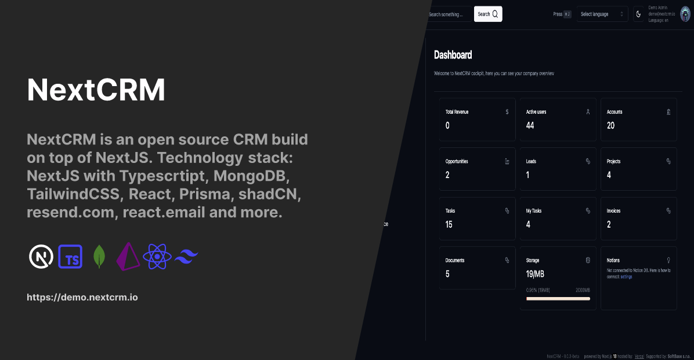

<h1 align="center">PharmaCRM</h1>

<p align="center">

</p>

<p align="center">
A CRM for pharmaceutical service companies — GMP/GDP audits, laboratory testing, validation and training — built with Next.js 16, React 19, TypeScript, PostgreSQL (Prisma 7) and shadcn/ui.
</p>

<p align="center">
  <a href="https://github.com/emmasaf/pharmacrm/blob/main/LICENSE">
    
  </a>
</p>

## Features

- **Accounts & contacts** — client companies, people, roles and full change history
- **Leads, targets & pipeline** — prospect lists, lead statuses, deals by sales stage with manager approval before qualification
- **Activities** — calls, meetings, emails and notes linked to any client or deal
- **Products & contracts** — service catalogue (audits, lab tests, validation, training) and contract lifecycle with renewal reminders
- **Invoices** — line items, VAT, multi-currency (incl. AMD), invoice series, payments and PDF export
- **Projects** — Kanban boards with sections, tasks, owners and due dates
- **Roles** — admin, manager and user; users only see records assigned to them
- **Audit log & soft delete** — every change is tracked, deleted records can be restored
- **Automation** — follow-up cadences, care tasks and renewal reminders via Inngest
- **AI** — semantic search, similar-record suggestions and contact enrichment (optional API keys)
- **MCP server** — let Claude and other AI agents read and update CRM data
- **i18n** — English, Czech, German, Ukrainian

## Getting started

Requirements: Node.js ≥ 22.12, pnpm 11, Docker.

```bash
git clone https://github.com/emmasaf/pharmacrm.git
cd pharmacrm
pnpm install

cp .env.example .env              # DATABASE_URL for the local Postgres
cp .env.local.example .env.local  # fill BETTER_AUTH_SECRET, ENCRYPTION_KEY (see comments)

pnpm inngest:up                   # Postgres (localhost:5433) + Inngest dev server (localhost:8288)
pnpm db:migrate
pnpm db:seed                      # lookup tables + admin user (TEST_USER_EMAIL)
pnpm db:seed:demo-am              # optional: Armenian pharma demo data
pnpm dev                          # http://localhost:3000
```

Sign-in uses a one-time email code. Without an email provider (`RESEND_API_KEY`) the code is not sent; read it from the database instead:

```bash
docker exec nextcrm-dev-postgres psql -U nextcrm -d nextcrm \
  -c 'select value from verification order by "createdAt" desc limit 1;'
```

### Demo data

`pnpm db:seed:demo-am` loads a fictional Armenian pharma dataset: 8 client companies, 16 contacts, 6 leads, 8 deals across the pipeline (AMD and USD), 3 contracts, 15 activities, 3 invoices with 20% VAT, a project board and a prospect list. It also adds a manager (`anahit.manager@pharmacrm.demo`) and a sales rep (`davit.sales@pharmacrm.demo`) to try role-based access. Re-running it updates the same records.

### Connecting Claude (MCP)

Generate a token on **Profile → Developer**, then:

```bash
claude mcp add --transport http pharmacrm http://localhost:3000/api/mcp/mcp \
  --header "Authorization: Bearer nxtc__your_token"
```

### Docker

`docker compose up -d` runs the full stack (app, Postgres, Inngest). See `.env.docker` for the variables it reads.

## Credits

PharmaCRM is based on [NextCRM](https://github.com/pdovhomilja/nextcrm-app) by Pavel Dovhomilja, released under the MIT license.

## License

[MIT](LICENSE)
